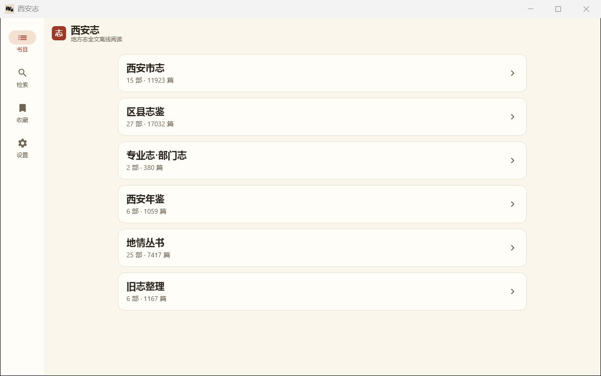
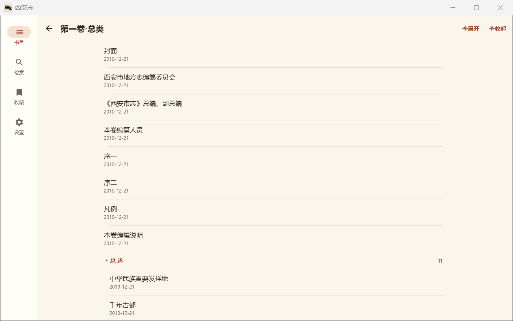
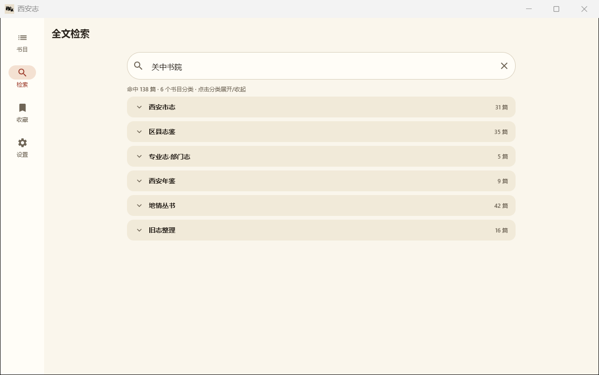
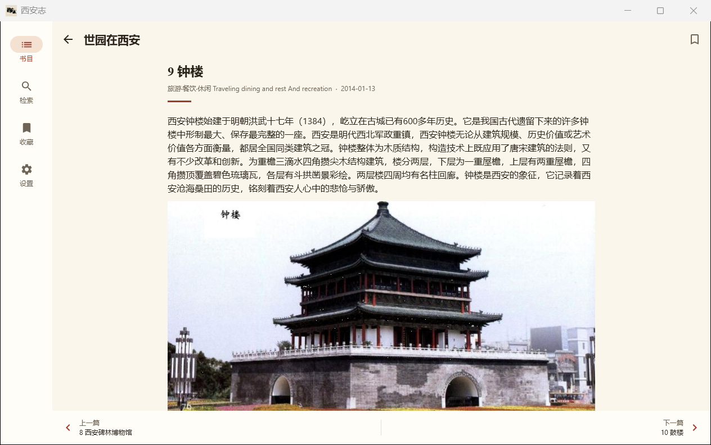

#  西安志

把西安市地方志办公室官网「志鉴浏览」已归档的地方志全文，做成离线可读、可全文检索的原生 App。

- **数据来源**：[xadfz.xa.gov.cn](http://xadfz.xa.gov.cn)（西安市地方志办公室官网，政府公开信息）
- **建设单位**：西安地名协会
- **技术栈**：Kotlin Multiplatform + Compose Multiplatform（Material 3）
- **目标平台**：Android + Windows（iOS 预留）
- **发布形态**：文字版（主力）+ 带图版（研究）

## 数据规模

全库共 **81 部书、38978 篇、约 6670 万字**正文，已全部内置在安装包内。

| 版本 | 主库 | 图片资源 | 说明 |
|---|---|---|---|
| 文字版 | `xianzhi.db`（166 MB） | 缺字图 4794 个（10.79 MB） | 主力版，体积小速度快 |
| 带图版 | `xianzhi_img.db`（167 MB） | 缺字图 + 配图 7975 张（514 MB） | 研究版，完整呈现原书面貌 |

## 功能

- **浏览**：栏目 → 书目 → 多级篇目目录树 → 阅读；目录树支持任意层级展开/收起、一键全部展开、记忆展开状态
- **阅读**：字号无级调节（14–28sp）、行距、浅色/深色主题、阅读位置记忆、上一篇/下一篇
- **检索**：全库全文检索，结果按书目大分类分组展示，分类头显示命中篇数、点击展开/收起，滚动时当前分类头吸附列表顶部便于随时折叠；命中超过提醒阈值（默认 500 条，可自定义）时询问是否继续并显示检索进度，达到上限（默认 2000 条，可自定义）自动停止；点击进入阅读页自动定位并高亮关键词；返回自动还原至原结果位置
- **收藏**：阅读时一键收藏篇目，自定义合集分组管理；支持新建/重命名/删除合集、按合集筛选浏览、在收藏对话框内一步新建合集
- **图片**：`⟦img:文件名⟧` 标记解析，文字版缺字图内嵌、带图版配图撑满可放大
- **设置**：字号行距主题、检索阈值（提醒/上限条数）、关于页（含 GitHub 官方发布与反馈渠道）

## 应用截图

| 书目分类 | 篇目目录 |
|---|---|
| [](docs/screenshots/books.png) | [](docs/screenshots/toc.png) |

| 全文检索（按书目分类分组） | 阅读（图文混排） |
|---|---|
| [](docs/screenshots/search.png) | [](docs/screenshots/reader.png) |

## 下载

最新版本：[**v0.3.2**](https://github.com/hupimaodaren/xianzhi-app/releases/tag/v0.3.2)

数据已全部内置，无需单独下载数据文件。

| 平台 | 纯文字版 | 完整图文版 |
|---|---|---|
| Android | `xianzhi-0.3.2-android-text.apk`（约 80 MB） | `xianzhi-0.3.2-android-image.apk`（约 594 MB） |
| Windows 安装程序 | `xianzhi-0.3.2-windows-text.exe`（约 168 MB） | `xianzhi-0.3.2-windows-image.exe`（约 664 MB） |
| Windows 便携免安装 | `xianzhi-0.3.2-windows-text-portable.zip`（约 168 MB） | `xianzhi-0.3.2-windows-image-portable.zip`（约 666 MB） |

同一 Release 内提供 `SHA256SUMS.txt`，下载后可校验完整性：

```bash
# Windows PowerShell
Get-FileHash xianzhi-0.3.2-windows-text.exe -Algorithm SHA256
```

> 说明：早期 `data v1` Release 中的数据资产（数据库、配图压缩包等）已全部清空删除，数据改由安装包内置分发，该 tag 仅作历史标记保留。

### v0.3.2 主要更新（检索结果分组展示）

1. **按书目大分类分组**：检索结果由平铺列表改为按六个书目大分类（西安市志、区县志鉴、专业志·部门志、西安年鉴、地情丛书、旧志整理）分组归类；每个分类头显示该类命中篇数，默认折叠，点击展开查看该类结果，无遗漏、无错配，类内保持原检索排序。
2. **分类头吸附**：展开长结果分类向下滚动时，当前分类头始终吸附在列表顶部，随时可点击折叠，无需滚回顶部；继续滚动进入下一分类时头部自然接替。
3. **移除分页**：分页条（含页码跳转）随分组展示取消，所有结果一次性归类呈现；阈值分级检索（500 条询问 / 2000 条上限）逻辑不变。

### v0.3.1 主要更新（检索功能专项升级）

1. **阈值分级检索**：单次搜索命中超过提醒阈值（默认 500 条）时暂停并询问「继续搜索 / 取消搜索」，继续后分批检索并实时显示进度；达到上限（默认 2000 条）自动停止并告知，取消则展示已检索到的前 500 条。
2. **阈值可自定义**：设置页新增「检索阈值」配置（提醒 100–5000 / 上限 500–20000），修改即时生效、自动保存、重启保留。
3. **页码直接跳转**：检索结果分页条新增「跳至第 X 页」，仅允许数字输入，超出范围自动标红并禁用跳转。
4. **关键词定位修复**：搜索结果片段中超长命中行围绕关键词截取窗口、关键词始终居中；修复偶发的进入正文后未滚动到命中段落的问题。

### v0.3.0 主要更新

1. **收藏功能**：阅读时点击书签图标即可收藏篇目，弹出合集选择对话框，支持选择已有合集或就地新建合集；在收藏页可移动、重命名、删除合集，按合集筛选浏览；导航栏新增「收藏」入口，与书目、检索、设置并列（设置保持末位以符合使用直觉）。
2. **搜索返回定位**：从搜索结果进入阅读页后返回，自动恢复到原结果页码与滚动位置，无需重新翻页查找。
3. **独立收藏库**：收藏数据保存在应用数据目录的 `favorites.db`，与只读志书主库分离，不影响原阅读数据与升级流程。

### v0.2.0 主要更新

1. **多级目录树**：书目目录由固定三级升级为任意层级可展开/收起的目录树，多分册结构（如《西安市志》各卷）层级清晰，支持一键全部展开/收起并记忆展开状态。
2. **篇目排序修正**：《西安市志（1991–2010）》等 21 部书的篇目顺序修正为官方编纂顺序（正文内容不变）。
3. **全文检索升级**：每页 50 条、最多返回前 500 条；每条结果展示命中词前后各两行上下文；点击结果进入阅读页自动定位到命中段落并高亮关键词。
4. **图标与更名**：Android / Windows 双端启用新应用图标，名称统一为「西安志」。
5. **关于页**：新增 GitHub 仓库链接，标注为官方发布与反馈渠道。

> 从 v0.1.0 升级的用户：若篇目排序未更新，请清除应用数据（Android）或删除 `%APPDATA%\xianzhi\data`（Windows）后重启，即可使用新版数据库。

## 安装与使用

### Android

1. 下载对应 APK（文字版体积小，推荐日常阅读；图文版适合研究原书面貌）
2. 安装时需允许「未知来源」应用
3. 首次启动会释放内置数据库到应用私有目录，约 1–2 分钟（图文版约需 700 MB 存储空间），期间有进度提示，请勿杀后台
4. 系统要求：Android 7.0（API 24）及以上

### Windows

**安装程序版（.exe）**：

1. 双击运行安装程序，可选择安装路径（默认 `%LOCALAPPDATA%\Programs\xianzhi`）
2. 因未购买代码签名证书，SmartScreen 可能提示「Windows 已保护你的电脑」，点击「更多信息」→「仍要运行」即可
3. 安装完成后从开始菜单启动

**便携免安装版（.zip）**：

1. 解压到任意目录（建议英文路径）
2. 运行 `xianzhi.exe`（文字版）或 `xianzhi-img.exe`（图文版）
3. 不写注册表、不生成开始菜单快捷方式，删除目录即完全卸载
4. 设置与数据存放在 `%APPDATA%\xianzhi`

系统要求：Windows 10/11 64 位。

## 给 Agent / Harness 使用（MCP Server）

本 App 的志书库不仅能用来阅读，还可以**直接接入本机 Agent**（Trae / Claude Desktop / Cursor / Windsurf 等）做全文检索。

配套项目：**[西安地方志 MCP Server](https://github.com/hupimaodaren/xianzhi-mcp)** —— 全离线、只读、无需联网与 API Key。

**数据库来源二选一**：

| 方式 | 说明 |
|------|------|
| **用本 App Windows 版自带的数据库**（已安装用户推荐） | 无需额外下载。EXE 安装版位于 `%APPDATA%\xianzhi\data\`；便携版位于解压目录 `app/resources/data/`。MCP Server 会自动发现 |
| **从 MCP 仓库单独下载** | 未装本 App 也能用：[xianzhi-mcp Releases](https://github.com/hupimaodaren/xianzhi-mcp/releases) 提供 `xianzhi.db`（166.6 MB，文字版），与 `xianzhi-mcp.exe` 放同一目录即可 |

> 下载 `xianzhi-mcp.exe`（约 31 MB，免装 Python）后，按 MCP 仓库 README 的「3 步上手」接入 Agent。
> 两种来源的数据库内容一致（38,978 篇），MCP Server 只读打开，不会修改你的志书库。

## 版权声明

**地方志正文及配图著作权归西安市地方志办公室及各编纂单位所有**，仅供个人学习研究使用，转载请注明出处。

本仓库「软件代码」采用 [MIT](LICENSE) 协议开源；数据文件以「内置分发」形式随安装包发布，不适用 MIT 协议。
